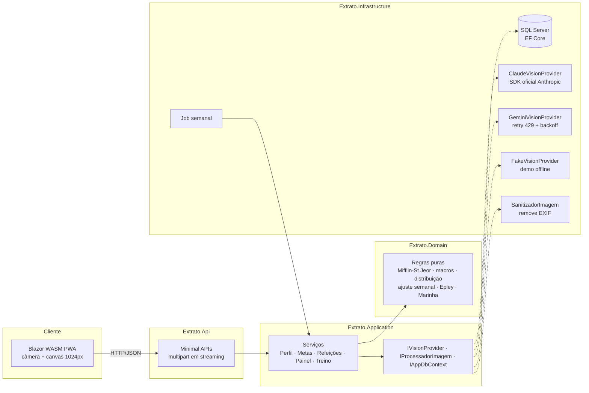

# extrato

App pessoal que monta metas de dieta a partir do perfil e do objetivo de treino, registra
refeições por **foto + descrição** e ajusta o restante do dia pelo que já foi consumido.

> Metáfora de extrato bancário: cada refeição e cada treino é um lançamento, e o painel mostra o **saldo do dia**.

**Stack:** .NET 10 · ASP.NET Core Minimal APIs · Clean Architecture · EF Core + **SQL Server** ·
Blazor WebAssembly (PWA) · Claude ou Gemini (visão) atrás de `IVisionProvider` · xUnit + FluentAssertions · Docker · GitHub Actions.

## Princípios

- **Nenhuma foto é armazenada.** Processada em memória, enviada à IA e descartada ([ADR 0001](docs/adr/0001-imagem-nao-persistida.md)).
- **A IA sugere, o usuário confirma.** Nada estimado entra no saldo sem confirmação.
- **Macros vêm da tabela, não da IA** — TACO ou rótulo ([ADR 0002](docs/adr/0002-macros-da-taco.md)).
- **Meta do dia estável, ajuste pela tendência semanal** ([ADR 0003](docs/adr/0003-meta-semanal.md)).
- **SQL Server** no lugar do PostgreSQL; busca por trigramas em C# ([ADR 0004](docs/adr/0004-sql-server-e-imagem-sem-dependencia-nativa.md)).

## Arquitetura



| Projeto | Responsabilidade |
|---|---|
| `Extrato.Domain` | Entidades e **regras de cálculo puras** (sem dependências) |
| `Extrato.Contracts` | DTOs compartilhados entre API e Blazor |
| `Extrato.Application` | Casos de uso, match de alimentos, contratos de IA/imagem/banco |
| `Extrato.Infrastructure` | EF Core/SQL Server, migrações, seed, Claude, Gemini, Fake, sanitizador, job |
| `Extrato.Api` | Endpoints, validação, ProblemDetails; hospeda o Blazor |
| `Extrato.Web` | Front Blazor WebAssembly instalável (PWA) |

## Rodando

### Docker (demo sem chave de API)

```bash
docker compose up --build
```

Abra http://localhost:8080. Sobe SQL Server + app com `FakeVisionProvider`, que interpreta a descrição
("2 conchas de arroz, filé ~150 g") e devolve um rascunho plausível — dá para testar o fluxo inteiro sem chave.

### Local (SQL Server Express/LocalDB)

```bash
dotnet run --project src/Extrato.Api
```

A connection string padrão está em `src/Extrato.Api/appsettings.json` (`localhost\SQLEXPRESS`, autenticação Windows).
Para LocalDB: `Server=(localdb)\MSSQLLocalDB;Database=Extrato;Trusted_Connection=True`.
As migrações e o seed (perfil inicial, amostra da TACO, favoritos) rodam na inicialização.

### IA de visão: Claude (recomendado) ou Gemini

O provedor é escolhido em `Visao:Provedor` (`Claude`, `Gemini` ou `Fake`). Vazio, a ordem é:
chave da Anthropic → Claude; senão chave do Gemini → Gemini; senão Fake (demo offline).

**Claude** — usa o SDK oficial `Anthropic` com saída estruturada (JSON Schema), `claude-opus-5-5`
com esforço `low` (identificar alimentos é tarefa simples e fica rápido), retries automáticos de 429/5xx
e fallback de modelo no servidor quando uma resposta é recusada.

```bash
dotnet user-secrets set "Claude:ApiKey" "sk-ant-..." --project src/Extrato.Api
```

A chave vem do [Console da Anthropic](https://platform.claude.com/) (cobrança por uso, separada da
assinatura do claude.ai). Modelo e esforço são configuráveis em `Claude:Modelo` e `Claude:Esforco`.

**Gemini** — alternativa com tier grátis:

```bash
dotnet user-secrets set "Gemini:ApiKey" "<sua-chave>" --project src/Extrato.Api
```

> ⚠️ No tier grátis do Gemini o conteúdo pode ser usado pelo Google. Use só para foto de prato, nunca do corpo.

Em qualquer provedor, falhas (limite de uso, timeout, JSON inválido, recusa) abrem o registro manual com a descrição já preenchida.

### Testes

```bash
dotnet test
```

96 testes: TMB/GET/macros (incluindo o exemplo da documentação: 2.830 kcal · 144 g P · 65 g G · 417 g C), travas,
redistribuição diária com piso, ajuste semanal (GET adaptativo, 2 semanas, 1×/semana), Epley, estagnação, dupla progressão,
% de gordura (Marinha), busca por trigramas, sanitização de EXIF, escolha do provedor de IA, fallback da IA e fluxos completos com EF InMemory.

## Importando a TACO completa

O seed traz ~55 alimentos comuns da TACO (4ª ed.) e dois itens de rótulo (whey, creatina).
Para a tabela completa, exporte um CSV `nome;kcal;proteina;carboidrato;gordura;fibra` (vírgula decimal) e envie:

```bash
curl -F "arquivo=@taco.csv" "http://localhost:5080/api/alimentos/importar?fonte=Taco"
```

## API

| Método | Rota | Função |
|---|---|---|
| GET/PUT | `/api/perfil` | Perfil |
| GET/PUT | `/api/regras` | Coeficientes (proteína/kg, gordura/kg, ajuste, pesos das refeições, travas) |
| GET/PUT | `/api/metas/atual` | Meta vigente / sobrescrever manualmente |
| GET | `/api/metas/simular` | Cálculo com racional, sem gravar |
| POST | `/api/metas/recalcular` | Recalcula a partir do perfil |
| POST | `/api/metas/ajuste-semanal` | Ajuste semanal (também roda por job) |
| POST | `/api/refeicoes/analisar-foto` | multipart `tipo`, `descricao`, imagem → rascunho (nada gravado) |
| GET/POST | `/api/refeicoes` | Refeições do dia / gravar refeição confirmada |
| PUT/DELETE | `/api/refeicoes/{id}` | Editar / remover |
| GET/POST | `/api/alimentos` | Busca aproximada / cadastro por rótulo |
| POST | `/api/alimentos/importar` | Importa CSV (TACO) |
| GET/POST/DELETE | `/api/favoritos` | Porções favoritas; `POST /api/favoritos/{id}/registrar?tipo=` lança a refeição |
| GET | `/api/painel/dia?data=` | Meta, consumido, restante, alvos por refeição e sugestões |
| POST | `/api/peso`, `/api/medidas` | Peso diário e medidas semanais |
| GET | `/api/progresso?de=&ate=` | Média móvel, medidas com % de gordura, ajustes, erro médio da IA |
| GET/POST | `/api/academias`, `/api/aparelhos`, `/api/rotinas` | Cadastro de treino |
| POST | `/api/aparelhos/analisar-foto` | Foto → rascunho do aparelho (descartado se houver pessoas) |
| POST/GET | `/api/sessoes`, `/api/sessoes/{id}` | Sessão com séries pré-preenchidas e comparação |
| POST | `/api/sessoes/{id}/series` | Registrar série |
| GET | `/api/evolucao/{aparelhoId}`, `/api/evolucao/semana` | 1RM estimado, recordes, estagnação, volume por grupo |

Em desenvolvimento o documento OpenAPI fica em `/openapi/v1.json`.

## Limites

O app **não substitui nutricionista**. As fórmulas (Mifflin-St Jeor, fatores de atividade, faixas de proteína,
7.700 kcal/kg) são referências consolidadas de nutrição esportiva; valide com um profissional antes de usá-las como regra fixa.
Uso pessoal, um único usuário.
