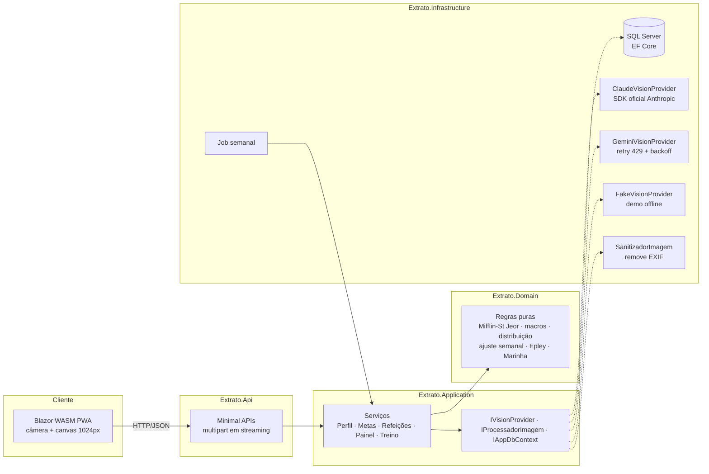

# extrato

App pessoal que monta metas de dieta a partir do perfil e do objetivo de treino, registra
refeições por **foto + descrição** e ajusta o restante do dia pelo que já foi consumido.

> Metáfora de extrato bancário: cada refeição e cada treino é um lançamento, e o painel mostra o **saldo do dia**.

**Stack:** .NET 10 · ASP.NET Core Minimal APIs · Clean Architecture · EF Core + **SQL Server** ·
Blazor WebAssembly (PWA) · Claude ou Gemini (visão) atrás de `IVisionProvider` · xUnit + FluentAssertions · Docker · GitHub Actions.

## Princípios

- **Nenhuma foto é armazenada.** Processada em memória, enviada à IA e descartada ([ADR 0001](docs/adr/0001-imagem-nao-persistida.md)).
- **A IA sugere, o usuário confirma.** Nada estimado entra no saldo sem confirmação.
- **Macros vêm da tabela, não da IA** — TACO ou rótulo ([ADR 0002](docs/adr/0002-macros-da-taco.md)).
- **Meta do dia estável, ajuste pela tendência semanal** ([ADR 0003](docs/adr/0003-meta-semanal.md)).
- **SQL Server** no lugar do PostgreSQL; busca por trigramas em C# ([ADR 0004](docs/adr/0004-sql-server-e-imagem-sem-dependencia-nativa.md)).

## Arquitetura



| Projeto | Responsabilidade |
|---|---|
| `Extrato.Domain` | Entidades e **regras de cálculo puras** (sem dependências) |
| `Extrato.Contracts` | DTOs compartilhados entre API e Blazor |
| `Extrato.Application` | Casos de uso, match de alimentos, contratos de IA/imagem/banco |
| `Extrato.Infrastructure` | EF Core/SQL Server, migrações, seed, Claude, Gemini, Fake, sanitizador, job |
| `Extrato.Api` | Endpoints, validação, ProblemDetails; hospeda o Blazor |
| `Extrato.Web` | Front Blazor WebAssembly instalável (PWA) |

## Rodando

### Docker (demo sem chave de API)

```bash
docker compose up --build
```

Abra http://localhost:8080. Sobe SQL Server + app com `FakeVisionProvider`, que interpreta a descrição
("2 conchas de arroz, filé ~150 g") e devolve um rascunho plausível — dá para testar o fluxo inteiro sem chave.

### Local (SQL Server Express/LocalDB)

```bash
dotnet run --project src/Extrato.Api
```

A connection string padrão está em `src/Extrato.Api/appsettings.json` (`localhost\SQLEXPRESS`, autenticação Windows).
Para LocalDB: `Server=(localdb)\MSSQLLocalDB;Database=Extrato;Trusted_Connection=True`.
As migrações e o seed (perfil inicial, amostra da TACO, favoritos) rodam na inicialização.

### IA de visão: Claude (recomendado) ou Gemini

O provedor é escolhido em `Visao:Provedor` (`Claude`, `Gemini` ou `Fake`). Vazio, a ordem é:
chave da Anthropic → Claude; senão chave do Gemini → Gemini; senão Fake (demo offline).

**Claude** — usa o SDK oficial `Anthropic` com saída estruturada (JSON Schema), `claude-opus-5-5`
com esforço `low` (identificar alimentos é tarefa simples e fica rápido), retries automáticos de 429/5xx
e fallback de modelo no servidor quando uma resposta é recusada.

```bash
dotnet user-secrets set "Claude:ApiKey" "sk-ant-..." --project src/Extrato.Api
```

A chave vem do [Console da Anthropic](https://platform.claude.com/) (cobrança por uso, separada da
assinatura do claude.ai). Modelo e esforço são configuráveis em `Claude:Modelo` e `Claude:Esforco`.

**Gemini** — alternativa com tier grátis:

```bash
dotnet user-secrets set "Gemini:ApiKey" "<sua-chave>" --project src/Extrato.Api
```

> ⚠️ No tier grátis do Gemini o conteúdo pode ser usado pelo Google. Use só para foto de prato, nunca do corpo.

Em qualquer provedor, falhas (limite de uso, timeout, JSON inválido, recusa) abrem o registro manual com a descrição já preenchida.

### Acesso (login)

O app tem um usuário só, protegido por login e senha (hash PBKDF2 no banco, sessão em cookie
`HttpOnly` + `SameSite=Strict`, válida por 30 dias). Toda a API exige login, exceto `/api/auth/*` e `/health`.
O login tem limite de 5 tentativas por minuto por IP.

**Primeiro acesso:** ao abrir o app pela primeira vez aparece a tela "Primeiro acesso" para criar login e senha.
Por segurança ela só funciona:
- no próprio computador onde o app está rodando (`localhost`), ou
- de outro aparelho, informando o código definido em `Auth:CodigoConfiguracao` (ex.: no Docker, `AUTH_CODIGO=... docker compose up`).

Assim ninguém cria a senha antes de você se o app estiver publicado. A senha pode ser trocada em **Ajustes → Acesso**.
Fora do modo de desenvolvimento o cookie exige HTTPS: publique atrás de um proxy com TLS.

### Testes

```bash
dotnet test
```

151 testes: TMB/GET/macros (incluindo o exemplo da documentação: 2.830 kcal · 144 g P · 65 g G · 417 g C), travas,
redistribuição diária com piso, ajuste semanal (GET adaptativo, 2 semanas, 1×/semana), Epley, estagnação, dupla progressão,
% de gordura (Marinha), busca por trigramas, integridade da TACO, ciclo treino/descanso, cardápio, relatórios, bloqueio da foto do corpo, sanitização de EXIF, escolha do provedor de IA, acesso (primeiro acesso, senha, login), fallback da IA e fluxos completos com EF InMemory.

## Fase 2

- **Dia de treino × descanso** (Ajustes → Regras): o dia de treino ganha carboidrato extra (padrão +200 kcal) e os
  dias de descanso perdem o mesmo total, então a média da semana não muda. Conta como treino o dia planejado
  (seg–sex por padrão) ou qualquer dia com sessão registrada. O descanso nunca fica abaixo da TMB.
- **Cardápio sugerido** (Painel → Cardápio em cada refeição que falta): combina proteína + carboidrato + complemento
  da TACO e calcula as gramas para o alvo da refeição. Respeita alimentos evitados e a rotina: a 1ª opção é o seu
  prato de costume ajustado ao alvo de hoje, as outras variam a proteína. Macros sempre da tabela, sem IA.
- **Relatórios** (Progresso → Relatórios): semana (7 dias) ou mês (30 dias) com aderência às calorias (±10%),
  proteína atingida (≥90%), médias, peso pela média móvel, cintura, treinos, recordes e ajustes da meta.
- **Avaliação corporal por foto** (Progresso → Medidas): só com o Claude (API paga) ou no modo demonstração; com o
  Gemini grátis o botão fica bloqueado e a imagem nunca sai do servidor. Exige consentimento a cada envio, devolve
  uma faixa de % de gordura e observações em texto; só isso é salvo, junto com as medidas. As metas continuam
  usando peso e medidas.

## Tabela de alimentos (TACO completa)

O app já vem com a **TACO 4ª edição revisada e ampliada** (NEPA/UNICAMP, 2011): 593 alimentos com
kcal, proteína, carboidrato, gordura e fibra por 100 g, em `src/Extrato.Infrastructure/Dados/taco.csv`
(embutido na DLL e carregado na inicialização). Fonte: [PDF oficial no NEPA/UNICAMP](https://nepa.unicamp.br/wp-content/uploads/sites/27/2023/10/taco_4_edicao_ampliada_e_revisada.pdf).

- Extraída do PDF oficial; 20 linhas com células em branco no PDF (óleos, sal, croquete, estrogonofe…)
  foram conferidas uma a uma. "Tr" (traço) e "NA" viram 0; fibra "NA" fica vazia.
- Ficam de fora os 4 itens que a TACO publica como "em análise" (`*`): iogurte sabor abacaxi, leite de vaca
  integral, leite desnatado UHT e coco verde. Os leites entram como alimentos **de rótulo** com valores típicos —
  ajuste pelo rótulo do seu leite em **Ajustes**.
- Aguardente e cerveja têm calorias que não fecham com os macros: vêm do álcool, como na TACO.
- O carregamento é idempotente: atualiza pelo nome, não duplica e não sobrescreve alimentos cadastrados por rótulo.

Outras tabelas podem ser importadas por CSV `nome;kcal;proteina;carboidrato;gordura;fibra` (vírgula decimal):

```bash
curl -b cookies.txt -F "arquivo=@tabela.csv" "http://localhost:5080/api/alimentos/importar?fonte=Taco"
```

## API

| Método | Rota | Função |
|---|---|---|
| GET | `/api/auth/sessao` | Estado do acesso (público) |
| POST | `/api/auth/configurar`, `/api/auth/login`, `/api/auth/logout`, `/api/auth/senha` | Primeiro acesso, login, logout, troca de senha |
| GET/PUT | `/api/perfil` | Perfil |
| GET/PUT | `/api/regras` | Coeficientes (proteína/kg, gordura/kg, ajuste, pesos das refeições, travas) |
| GET/PUT | `/api/metas/atual` | Meta vigente / sobrescrever manualmente |
| GET | `/api/metas/simular` | Cálculo com racional, sem gravar |
| POST | `/api/metas/recalcular` | Recalcula a partir do perfil |
| POST | `/api/metas/ajuste-semanal` | Ajuste semanal (também roda por job) |
| POST | `/api/refeicoes/analisar-foto` | multipart `tipo`, `descricao`, imagem → rascunho (nada gravado) |
| GET/POST | `/api/refeicoes` | Refeições do dia / gravar refeição confirmada |
| PUT/DELETE | `/api/refeicoes/{id}` | Editar / remover |
| GET/POST | `/api/alimentos` | Busca aproximada / cadastro por rótulo |
| POST | `/api/alimentos/importar` | Importa CSV (TACO) |
| GET/POST/DELETE | `/api/favoritos` | Porções favoritas; `POST /api/favoritos/{id}/registrar?tipo=` lança a refeição |
| GET | `/api/painel/dia?data=` | Meta (do dia de treino/descanso), consumido, restante, alvos por refeição e sugestões |
| GET | `/api/cardapio?tipo=&data=` | Cardápio sugerido para uma refeição |
| GET | `/api/relatorios?periodo=semana\|mes&ate=` | Relatório semanal ou mensal |
| GET/POST | `/api/medidas/foto-permitida`, `/api/medidas/analisar-foto` | Avaliação corporal por foto (provedor pago) |
| POST | `/api/peso`, `/api/medidas` | Peso diário e medidas semanais |
| GET | `/api/progresso?de=&ate=` | Média móvel, medidas com % de gordura, ajustes, erro médio da IA |
| GET/POST | `/api/academias`, `/api/aparelhos`, `/api/rotinas` | Cadastro de treino |
| POST | `/api/aparelhos/analisar-foto` | Foto → rascunho do aparelho (descartado se houver pessoas) |
| POST/GET | `/api/sessoes`, `/api/sessoes/{id}` | Sessão com séries pré-preenchidas e comparação |
| POST | `/api/sessoes/{id}/series` | Registrar série |
| GET | `/api/evolucao/{aparelhoId}`, `/api/evolucao/semana` | 1RM estimado, recordes, estagnação, volume por grupo |

Em desenvolvimento o documento OpenAPI fica em `/openapi/v1.json`.

## Limites

O app **não substitui nutricionista**. As fórmulas (Mifflin-St Jeor, fatores de atividade, faixas de proteína,
7.700 kcal/kg) são referências consolidadas de nutrição esportiva; valide com um profissional antes de usá-las como regra fixa.
Uso pessoal, um único usuário.
